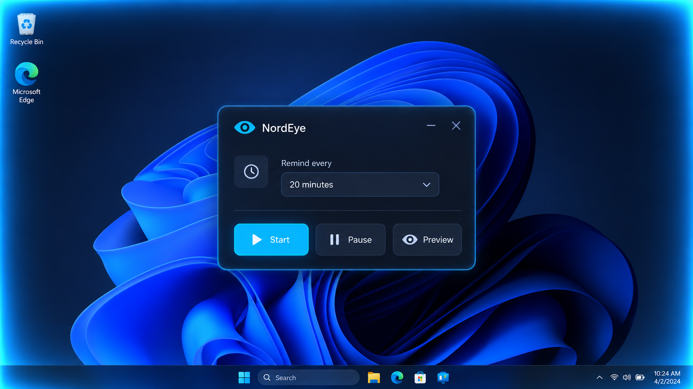

# NordEye

NordEye is a compact Windows application that reminds you to rest your eyes by displaying a soft blue glow around the edges of every screen. It is written for AutoHotkey v2 and requires no Electron runtime, browser, or external graphics package.

## Features

- Reminder intervals of 5, 10, 20, 30, 45, or 60 minutes; the default is 20 minutes.
- A translucent ambient glow that fades from the screen edges toward the centre.
- Smooth appearance, pulse, and dismissal animations.
- The glow remains visible until you press **Esc**.
- Click-through overlays for every monitor connected when the application starts.
- A compact control window with system-tray support.
- No duplicated overlay when a reminder is already visible.

## Requirements and use

1. Install [AutoHotkey v2](https://www.autohotkey.com/).
2. Download `NordEye_Ambient_Glow.ahk`.
3. Double-click the script.
4. Select an interval and choose **Start**.

The application uses the Windows GDI+ API. **Pause** disables future reminders, **Preview** displays the glow immediately, and **Esc** dismisses an active glow without stopping the schedule. Closing the control window hides it in the tray; use the tray's **Exit** command to stop the application completely.

## Implementation notes

Each monitor receives a transparent, non-activating layered window in click-through mode. NordEye prepares an ARGB edge-gradient image and animates its overall opacity through `UpdateLayeredWindow` rather than rebuilding the gradient on every frame.

Monitor changes are not detected while the application is running; restart it after connecting or disconnecting a display. Settings are not persisted between launches. The included `NordEye_Transparent.ico` is an optional design resource and is not assigned automatically. The repository contains source code only, not a standalone EXE.

## Files

- `NordEye_Ambient_Glow.ahk` — application source.
- `NordEye.png` — documentation screenshot.
- `NordEye_Transparent.ico` — optional icon.
- `CHANGELOG.md` — confirmed release history.

Licensed under the MIT License. See [LICENSE.txt](LICENSE.txt).
